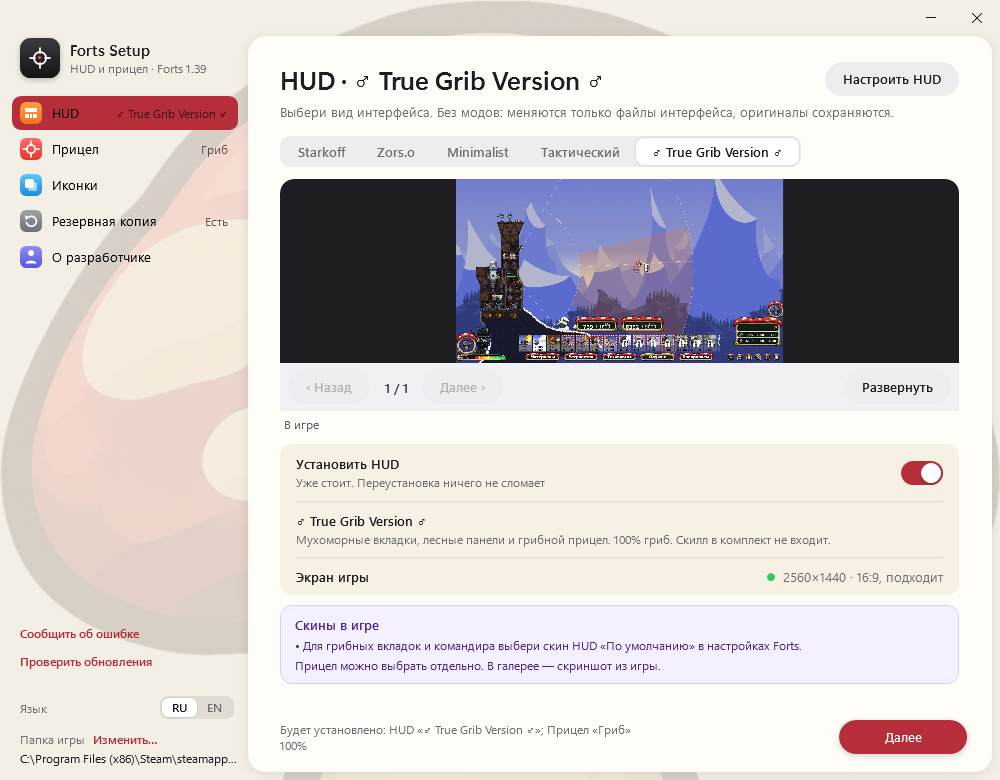
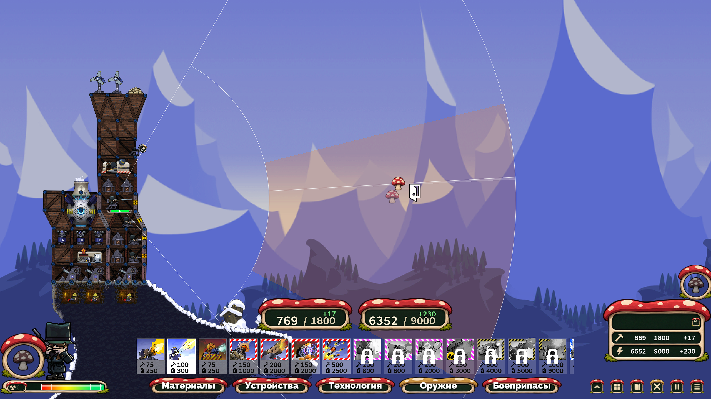

# Forts Setup

Установщик HUD и прицелов для Forts на Windows. Сохраняет оригинальные файлы:
изменения можно отменить через раздел «Резервная копия».

**[Скачать последнюю версию](https://github.com/DaniilMokhnatkin/forts-compact-hud/releases/latest)**

- Пять HUD: Starkoff, Zors.o, Minimalist, Тактический и ♂ True Grib Version ♂.
- Прицел выбирается отдельно. Размер — 50–200%.
- В настройках HUD можно включить или выключить строительство через прозрачные фоновые области.
- Настройка положения ресурсов и прозрачности значков тушения, стройки, ремонта и демонтажа.
- Русский и английский интерфейс, проверка обновлений.

## Установка

1. Закрой Forts и скачай EXE из последнего релиза. В ZIP лежит тот же установщик.
2. Запусти сетап, выбери HUD и прицел, подтверди установку.
3. Выставь настройки из таблицы ниже и запусти игру.

В Forts открой **Настройки → Игра**:

| HUD | Что выбрать |
| --- | --- |
| Starkoff | Одинаковый скин HUD в игре и в сетапе. |
| Zors.o | Скин HUD **и скин меню** — «По умолчанию». |
| Minimalist, Тактический, True Grib Version | Скин HUD — «По умолчанию». |

После смены скина перезапусти Forts. Раскладки рассчитаны на экран 16:9.

## Свой фон меню

В разделе **«Фон меню»** доступны три встроенных набора: **«Горный закат»**,
**Zors.o** и **«Грибной лес»**. Выбери набор либо загрузи свой PNG, JPG или BMP
и нажми **«Установить»**. Встроенные изображения уже входят в EXE.
Для главного меню и остальных экранов можно выбрать разные изображения.
Картинка обрезается по центру до 16:9 и преобразуется в 1920×1080; результат
виден в предпросмотре. Прозрачные области станут чёрными.

Эта страница меняет только фоны. Поддерживаются стандартные темы меню и DLC;
сезонные темы могут использовать свои изображения. Закрой Forts перед установкой
и запусти снова после неё. Смена HUD сохраняет выбранный фон.

**«Убрать»** отменяет выбор картинки до установки. **«Вернуть сохранённые фоны»**
возвращает файлы из резервной копии сетапа; если до установки уже стоял свой фон,
вернётся он. Изменённые извне файлы защищены от перезаписи.

## Скриншоты

## Разработка

Код сетапа — `setup/native/`, раскладки — `layouts/`, сборка — `tools/`.
[Сборка и заметки по интерфейсу](docs/development.md) · [История изменений](CHANGELOG.md).

Оформление Zors.o — [Zors.o](https://steamcommunity.com/profiles/76561199099877561),
Minimalist — [nutellafish](https://steamcommunity.com/sharedfiles/filedetails/?id=3750502564).
Тактический HUD основан на интерфейсе [RobberFox](https://www.youtube.com/@robber_fox/videos).
