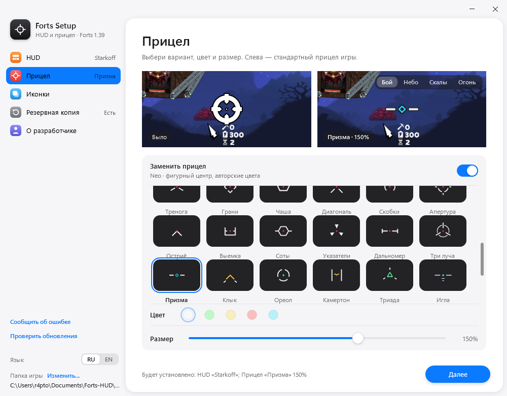

# Duo / Neo crosshairs

32 additional choices in Forts Setup 1.11.0, alongside the existing 20 cursors.

- **Duo:** 16 white reticles with a red aiming point and dark outlines.
- **Neo:** 16 shapes with cyan, amber, mint or violet accents. Hollow diamonds,
  crosses, rings and chevron tips mark the centre; no red dots.



The picker uses six equal columns across the available width. Original colours
are preserved for both packs, including after switching from a tinted classic
cursor. Every choice supports 50–200% size in 5% steps, both cursor states,
installation status detection and restoration.

[Duo concept sheet](duo-concepts.png) · [Neo concept sheet](neo-concepts.png) ·
[ImageGen prompts](prompts.md)

The concept sheets came from built-in ImageGen. Final game art is constructed
from geometry, not cropped from the sheets: `tools/draw_crosshair_packs.py`
produces transparent 64×64 DDS files with a (32, 32) hotspot and PNG thumbnails.
The full build runs it automatically. To rebuild the textures alone:

```powershell
py -3 tools\draw_crosshair_packs.py
```

Validation: 60 native engine checks, 102 WPF UI checks and 7 downloader checks
passed. The UI test selects every new cursor, checks its real size preview and
verifies balanced left/right grid gaps. Native texture checks covered 32 unique
images, alpha, outlines, Duo red centres, no red in Neo, 992 size previews and
768 resized DDS files. Real-match use has not been tested.
